<p align="center">
  
</p>

<h1 align="center">Ember</h1>

<p align="center">
  Windows software for the <b>Turing Smart Screen 3.5"</b> (TURZX) USB display.<br>
  Animated themes, a layout editor and real CPU and GPU temperatures, without the 1 fps.
</p>

<p align="center">
  <a href="https://github.com/cybvlsky/Ember/releases/latest"><b>Download the installer</b></a>
</p>

<p align="center">
  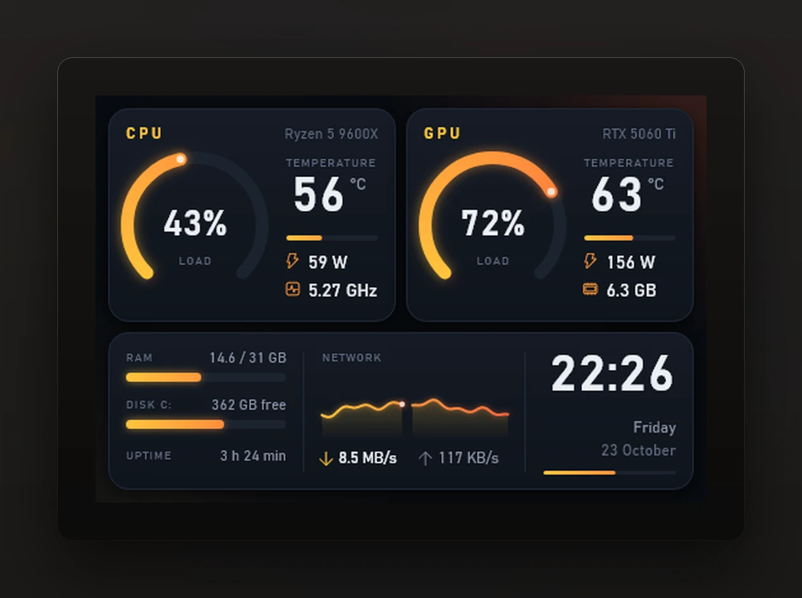
</p>

The little 3.5" screens sold as Turing Smart Screen, TURZX or USB35INCHIPSV2 come with an app that updates about once a second. Ember runs in the tray, starts with Windows and keeps the screen moving: gauges sweep, the network graph runs like a scope trace and the seconds flow, for about 0.3% of the CPU.

## Install

1. Download `Ember-Setup-x.y.z.exe` from [Releases](https://github.com/cybvlsky/Ember/releases/latest).
2. Run it. Ember ships with its own .NET runtime, so there is nothing else to install. It goes into the Start menu and starts with Windows.
3. Leave *Install the PawnIO driver* ticked if you want CPU temperature (see [Sensors](#sensors)).

The installer isn't code-signed yet, so SmartScreen may say "Windows protected your PC". Click *More info*, then *Run anyway*. Uninstall it from Settings > Apps like anything else. Your own themes stay in `%APPDATA%\Ember`.

Windows 10 or 11, 64-bit.

**Which screen.** Ember talks to the Turing Smart Screen 3.5" revision A: USB ID `1a86:5722`, shows up as a COM port, sold under the Turing and TURZX names. The 2.1", 5" and 8.8" models and the XuanFang revision B speak other protocols and don't work yet. Close the vendor app first, only one program can hold the port.

## Themes

Eight come built in. Every one of them was tuned against the link budget described [below](#why-the-stock-software-runs-at-1-fps), so they stay smooth on the real panel, not only in screenshots.

<table>
  <tr>
    <td width="50%">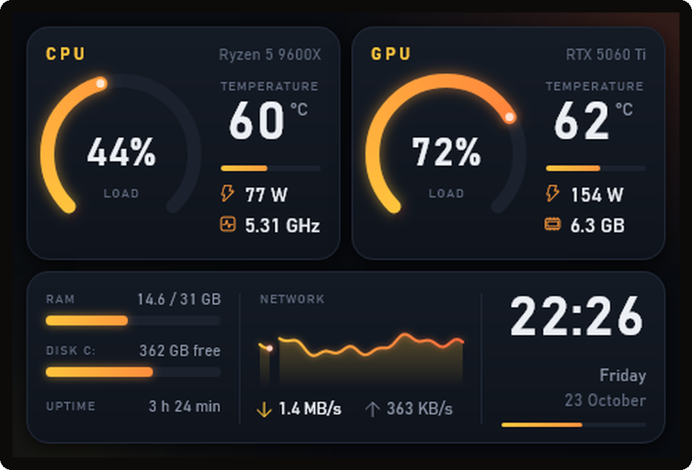<br><b>Ember</b><br>Warm amber. CPU and GPU in rings, the network as a scope trace, a clock with flowing seconds.</td>
    <td width="50%">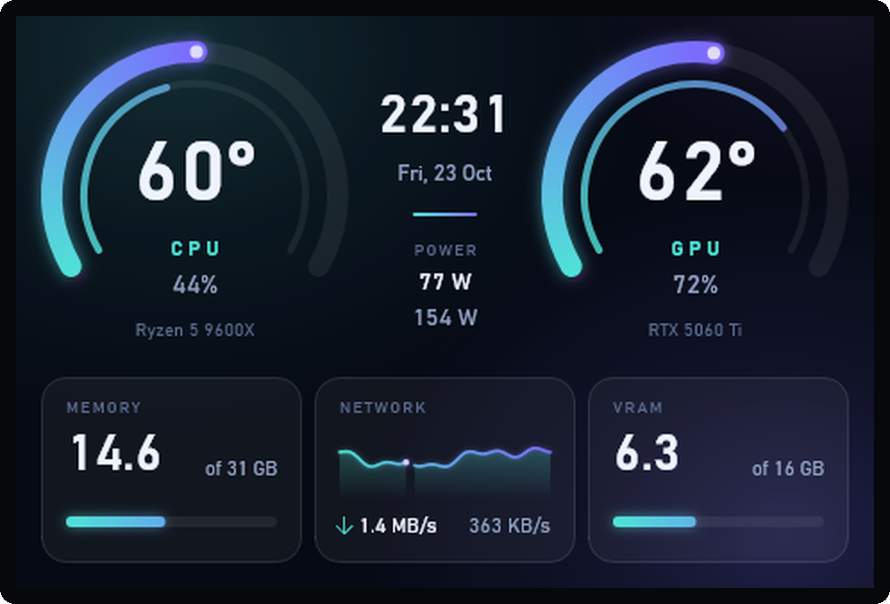<br><b>Aurora</b><br>Teal and violet on frosted glass. Temperatures in the big arcs, load in the inner ring.</td>
  </tr>
  <tr>
    <td>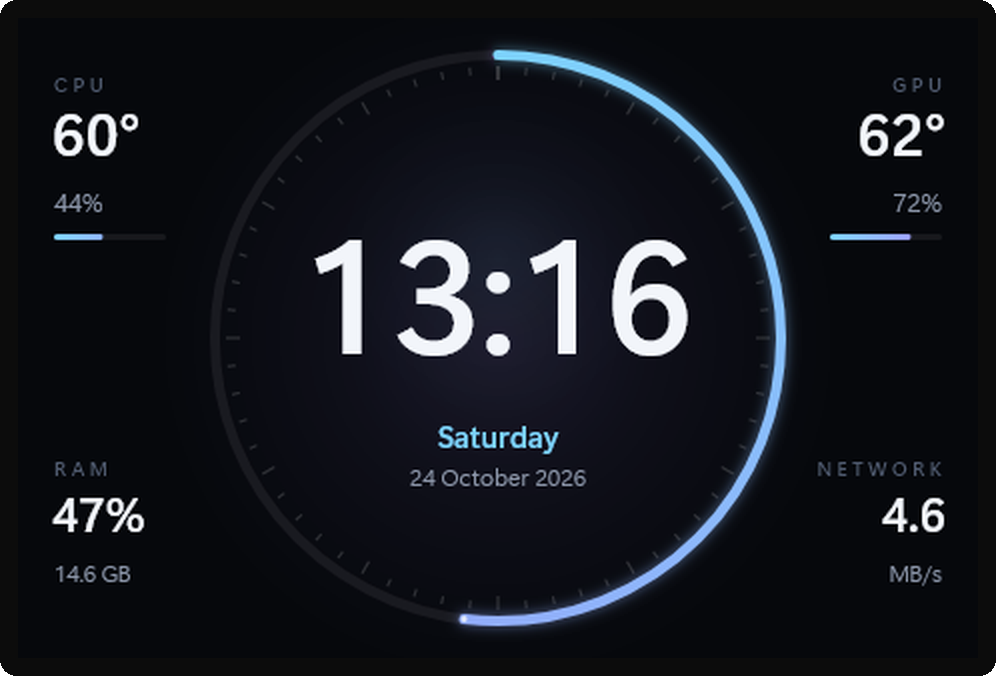<br><b>Clock</b><br>A big clock with a smooth seconds ring and temperatures on the sides.</td>
    <td>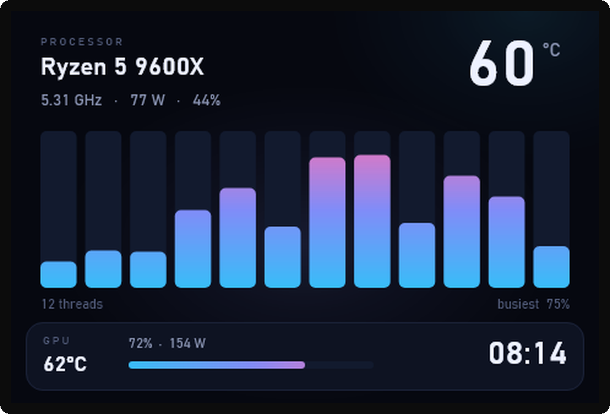<br><b>Cores</b><br>Every CPU thread as its own bar, so you can see what the processor is really doing.</td>
  </tr>
  <tr>
    <td>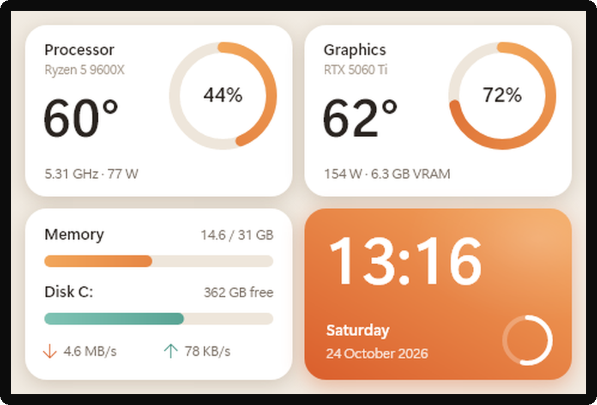<br><b>Latte</b><br>Light and warm: cream tiles, soft shadows, a caramel accent.</td>
    <td>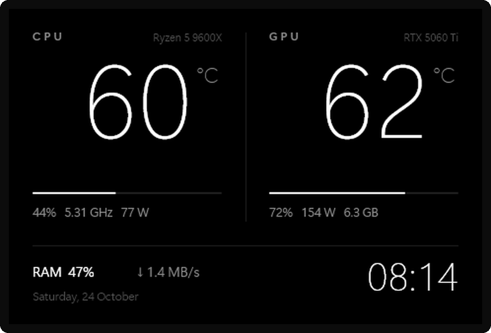<br><b>Mono</b><br>Black, white and big thin digits. Readable from across the room.</td>
  </tr>
  <tr>
    <td>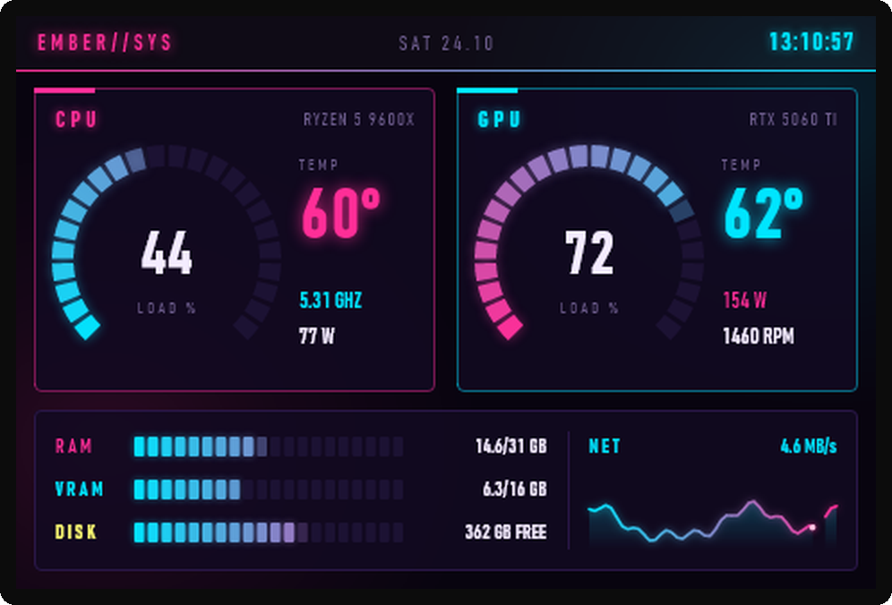<br><b>Neon</b><br>Magenta and cyan, segmented LED gauges, glowing digits.</td>
    <td>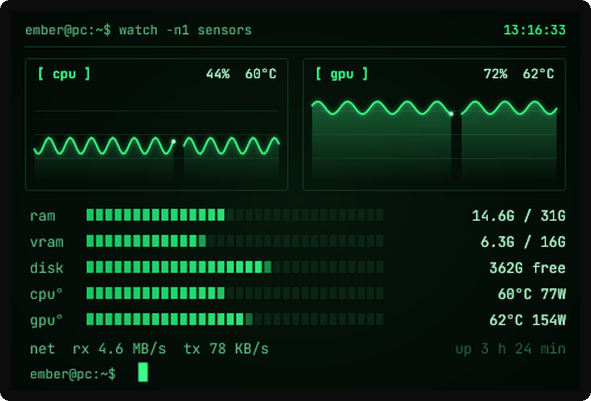<br><b>Terminal</b><br>Green phosphor and scope traces, for people who live in a console.</td>
  </tr>
</table>

## The app

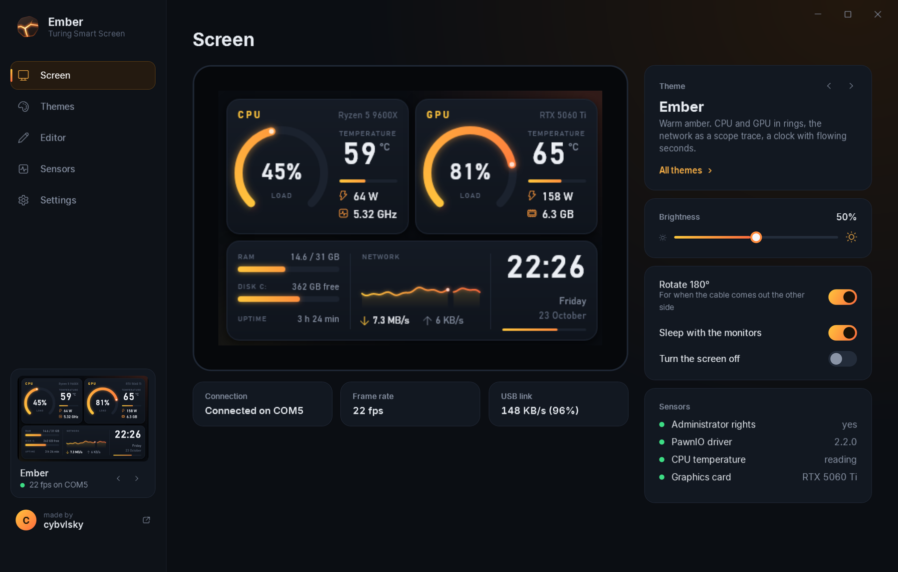

The Screen page mirrors the panel live. From here you switch themes, set brightness and rotation, and see at a glance whether CPU temperature is readable. The sidebar keeps a small live copy of the panel on every page.

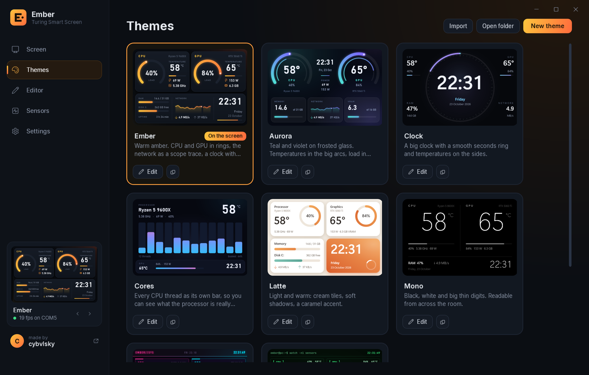

The gallery thumbnails run on your own sensor data. Click one to put it on the screen.

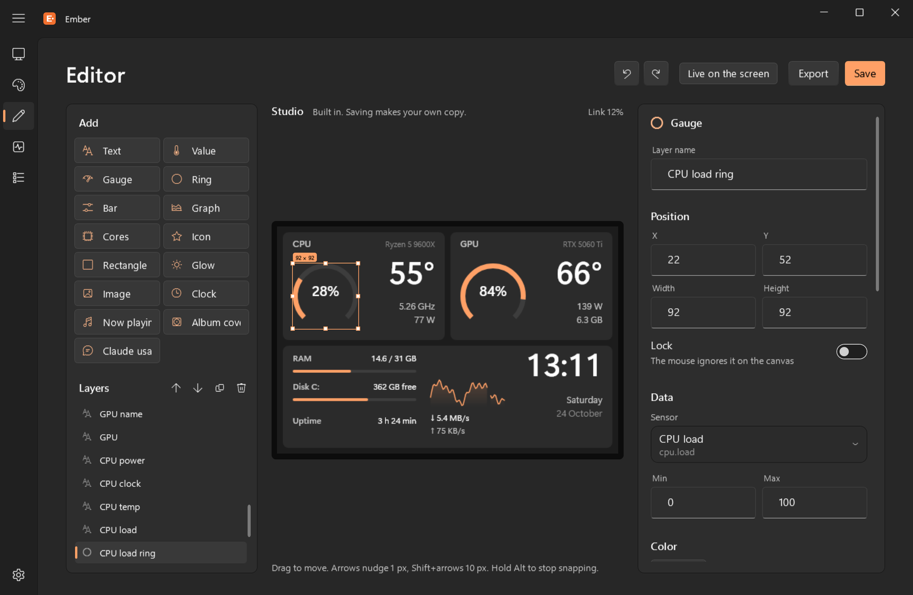

The editor is a canvas with layers. Drag things, resize them, let them snap to each other's edges and centres, and change any property on the right. Everything can be undone. Turn on *Live on the screen* and each change lands on the panel while you make it. The sidebar folds into an icon rail while you edit, so the canvas gets the room.

The tray icon has the rest: theme, brightness, turn the screen off, quit. When Windows turns the monitors off or the PC goes to sleep, the panel goes dark too.

## Why the stock software runs at 1 fps

The panel's USB link moves about 157 KB/s, whatever baud rate you ask for. A full 480 × 320 frame in RGB565 is 300 KB, so redrawing the whole screen takes almost two seconds.

Ember never redraws the whole screen. Each frame is rendered in memory with SkiaSharp, in under a millisecond, and compared with what the panel already shows in 16 × 8 pixel tiles. Only the rectangles that changed go over the wire, the oldest first, within a budget per frame, so a big change arrives over a few frames instead of freezing everything else. The themes are drawn with that in mind: digits have fixed widths so going from 41 to 42 resends one glyph, gauges move in half-pixel steps, graphs sweep like an oscilloscope instead of scrolling, and the RGB565 dithering uses a fixed pattern so pixels that didn't change stay identical.

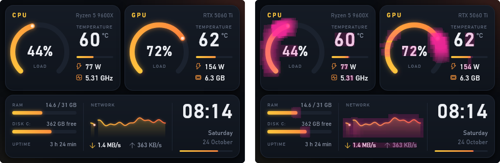

On the right, pink marks every pixel that crossed the link during ten seconds of the Ember theme. That is about 88 KB/s, 57% of what the link carries, and the reason the small animations reach 20 to 30 fps.

The same budget shapes the start-up card and theme changes. Fading pixels would take seconds, but the backlight is a 6-byte command, so Ember draws each new picture with the backlight off and fades the backlight up.

<p align="center">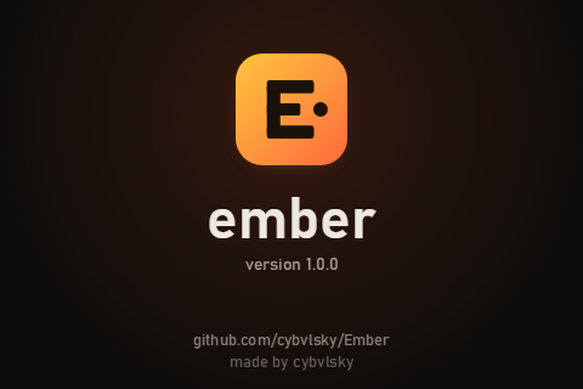</p>

## Sensors

Ember reads the hardware through [LibreHardwareMonitor](https://github.com/LibreHardwareMonitor/LibreHardwareMonitor):

- CPU: load overall and per thread, clock, power, temperature
- GPU (NVIDIA, AMD, Intel): load, temperature, hot spot, memory junction, clocks, power, fan, VRAM
- RAM, the system drive, network upload and download, uptime, time and date

Any other sensor LibreHardwareMonitor finds is available too. The Sensors page lists them all with their keys.

CPU temperature needs administrator rights and the PawnIO driver. Ember starts itself from Task Scheduler with administrator rights, so there is no UAC prompt at logon. [PawnIO](https://github.com/namazso/PawnIO.Setup) is the signed driver LibreHardwareMonitor now uses in place of WinRing0, the old driver that many monitoring tools shipped and that antivirus software flags. The installer, or the button on the Screen page, downloads the official PawnIO setup and checks that it is signed by its author before running it.

Ember leaves the riskier parts of LibreHardwareMonitor off: memory SPD over SMBus is never touched and motherboard sensors are opt-in.

## What it costs

Measured on a Ryzen 5 9600X with an RTX 5060 Ti, window closed, default theme:

| | |
|---|---|
| CPU | about 0.3% (33 ms of work per second) |
| GPU | 0% |
| Memory | about 70 MB |
| DPC and interrupt time | no measurable change |

With the window open it uses around 2% while it is on screen, most of it for the live preview. Minimised or closed, the window stops drawing.

If you write your own monitoring tool, one thing worth knowing: LibreHardwareMonitor asks NVIDIA for PCIe throughput on every update, two NVML calls that each wait about 30 ms in the driver. Ember switches that off.

## Make your own theme

The editor is the easy way. Themes are JSON files in `%APPDATA%\Ember\themes`, so you can also write them by hand and share them with *Export* and *Import*.

```json
{
  "name": "Mine", "font": "Bahnschrift", "bg": "#0D0C0B",
  "palette": { "a1": "#FFB347", "a2": "#FF6A1F", "text": "#EEE8E2", "track": "#2A2623" },
  "widgets": [
    { "type": "gauge", "x": 20, "y": 44, "w": 116, "h": 116, "sensor": "cpu.load", "colors": ["a1", "a2"], "glow": 10, "mode": "dot" },
    { "type": "text", "x": 78, "y": 90, "align": "center", "text": "{cpu.temp:0}°", "size": 28, "sensor": "cpu.temp", "warn": 80, "crit": 90 }
  ]
}
```

Widgets are drawn in order, first at the bottom. Colours are `#RGB`, `#RRGGBB`, `#RRGGBBAA` or a palette name, optionally with an opacity like `a1/30`. With `warn` and `crit` set, the colour shifts smoothly to the palette's `warn` and `crit` colours.

| Type | For | Main fields |
|---|---|---|
| `text` | labels and values | `text` with `{key:format}`, `font`, `size`, `weight`, `stretch`, `align`, `spacing`, `glow`, `mode`: `upper`, `blink` |
| `gauge` | arcs and rings | `sensor`, `min`, `max`, `thickness`, `start`, `sweep`, `segments`, `gap`, `mode`: `dot`, `flat`, `ticks`, `alternate` |
| `bar` | bars | `sensor`, `min`, `max`, `radius`, `segments`, `gap`, `mode`: `vertical` |
| `graph` | history | `sensor`, `points`, `max` (leave out for automatic), `mode`: `sweep`, `dot`, `grid`, `sharp`, `nofill` |
| `cores` | a bar per CPU thread | `sensor` is the prefix (`cpu.t`), `gap`, `radius` |
| `rect`, `glow`, `icon`, `image` | backgrounds, cards, glows, Segoe Fluent icons, pictures | `color` or `colors`, `angle`, `radius`, `stroke`, `shadow`, `glyph`, `src` |

Formats inside `{}`: any .NET number format (`0`, `0.0`), `rate` (bytes per second as KB/s or MB/s), `ratev` and `rateu` (just the number or just the unit), `mbit`, `ghz`, and date formats for `{time}` and `{date}` (`HH:mm`, `dddd, d MMMM`). Text in the built-in themes follows the interface language. Click any row on the Sensors page to copy its key.

## Languages

The interface and the built-in themes come in English and Polish (Settings > Language), including day names and decimal separators on the panel. A new language is one dictionary in [`Strings.cs`](Strings.cs).

## Building

You need the [.NET 9 SDK](https://dotnet.microsoft.com/download).

```
git clone https://github.com/cybvlsky/Ember
cd Ember
dotnet run -c Release
```

A few switches help while working on it:

- `Ember.exe --selftest` checks the protocol encoding, colour conversion, the diff sender against a virtual panel, the translations and every theme in both languages.
- `Ember.exe --render <folder>` writes a PNG of every theme, its bandwidth heat map and a bandwidth report.
- `Ember.exe --demo` runs on made-up sensor readings.
- `python tools/make-docs.py <Ember.exe>` rebuilds the images in this README.

## Releases

GitHub Actions builds every release from a tag. Add a `## x.y.z` section to [CHANGELOG.md](CHANGELOG.md), commit, then `git tag vx.y.z` and `git push --tags`. The workflow runs the self-test, builds a self-contained installer with Inno Setup and publishes the release with that changelog section as its notes.

## Credits

- [LibreHardwareMonitor](https://github.com/LibreHardwareMonitor/LibreHardwareMonitor) (MPL 2.0) reads the sensors.
- [PawnIO](https://github.com/namazso/PawnIO.Setup) by namazso gives it safe access to the CPU.
- [SkiaSharp](https://github.com/mono/SkiaSharp) (MIT) draws everything.
- [Inter](https://github.com/rsms/inter) by Rasmus Andersson (SIL OFL 1.1) is the interface font.
- [turing-smart-screen-python](https://github.com/mathoudebine/turing-smart-screen-python) by mathoudebine documented the panel's protocol.

Ember is not affiliated with Turing or TURZX.

## License

[MIT](LICENSE)
